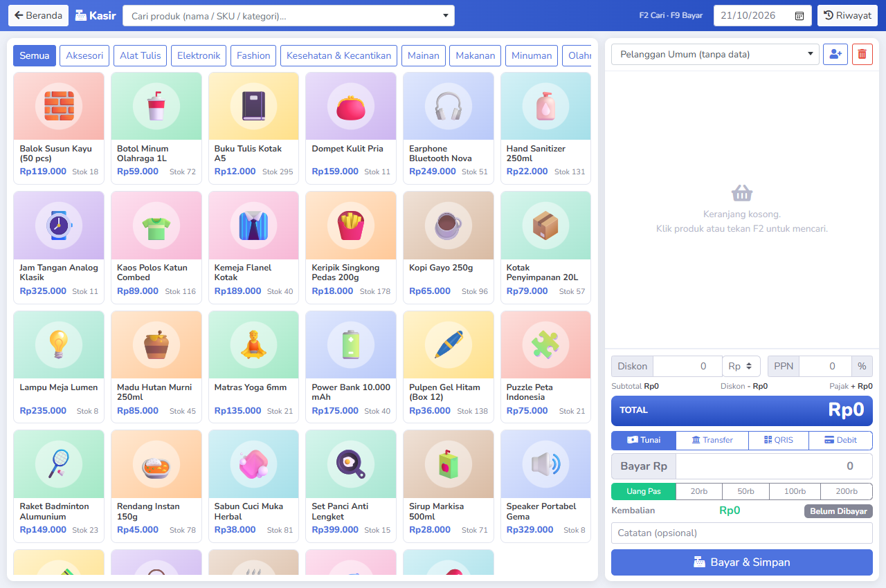

# Sistem Inventaris & Penjualan (POS) - LSP Web Development

Aplikasi berbasis web untuk manajemen inventaris barang dan sistem kasir penjualan (*Point of Sale*) yang dikembangkan menggunakan **Laravel 11**, arsitektur MVC, database **MySQL**, dan antarmuka responsif berbasis **SB Admin 2 (Bootstrap 4)**.

---

## Tampilan Antarmuka Kasir (POS)

Berikut adalah tampilan antarmuka kasir penjualan (*Point of Sale*) dengan pemilihan produk cepat, keranjang belanja real-time, kalkulasi diskon, pajak, dan berbagai metode pembayaran:



---

## Fitur Utama Aplikasi

1. **Sistem Otentikasi & Keamanan Sesi:**
   - Halaman login modern dengan gaya SB Admin 2.
   - Proteksi seluruh rute manajemen dan kasir menggunakan middleware otentikasi.
   - Informasi profil pengguna aktif pada topbar dan modal konfirmasi logout yang aman.
2. **Dashboard & Statistik Bisnis:**
   - Ringkasan metrik statistik: Total Pengguna, Total Produk, Total Pelanggan, Total Transaksi, dan Total Pendapatan.
   - Pintasan cepat (*quick links*) ke semua modul utama.
3. **Manajemen Inventaris Produk (Katalog & Stok):**
   - CRUD Produk lengkap (Nama, Kategori, SKU unik, Harga, Stok, Deskripsi).
   - Pengelompokan kategori dan status ketersediaan stok (Tersedia / Kritis / Habis).
   - Dukungan unggah gambar produk (SVG, JPG, PNG, WEBP) dengan preview otomatis.
4. **Manajemen Pelanggan:**
   - Pencatatan data master pelanggan, nomor kontak/telepon, dan alamat lengkap.
   - Riwayat riil transaksi yang terhubung dengan pelanggan.
5. **Modul Transaksi Kasir (POS):**
   - Desain kasir layar penuh (*clean interface*).
   - Pencarian instan dan filter kategori produk secara interaktif.
   - Keranjang belanja dinamis dengan penyesuaian kuantitas barang.
   - Kalkulasi otomatis subtotal, diskon (nominal atau persentase), dan pajak (PPN).
   - Metode pembayaran fleksibel: Tunai (dengan hitung kembalian dan tombol nominal cepat), Transfer Bank, QRIS, dan Kartu Debit.
6. **Riwayat Penjualan & Invoice:**
   - Daftar seluruh transaksi penjualan dengan kode transaksi unik.
   - Filter berdasarkan status pembayaran (*Lunas*, *Sebagian*, *Belum Dibayar*).
   - Tampilan rincian struk pembelian belanja.
7. **Manajemen Pengguna (User):**
   - Pengelolaan akun sistem untuk berbagai peran staf operasional.

---

## Akun Login Awal (Default Credentials)

Setelah menjalankan seeder database, sistem telah menyediakan akun administrator dan staf untuk pengujian:

| Peran (Role) | Alamat Email | Kata Sandi | Keterangan |
| :--- | :--- | :--- | :--- |
| **Administrator** | `admin@example.com` | `password` | Akses penuh ke seluruh modul sistem |
| **Kasir** | `kasir@example.com` | `password` | Akun staf kasir penjualan |
| **Gudang** | `gudang@example.com` | `password` | Akun petugas logistik & stok barang |
| **Tester** | `test@example.com` | `password` | Akun pengujian umum |

> **Catatan:** Seeder admin login tersedia pada kelas `Database\Seeders\AdminSeeder` dan otomatis dijalankan saat proses seeding database.

---

## Persyaratan Sistem

- **PHP** >= 8.2 (dengan ekstensi `pdo_mysql`, `mbstring`, `openssl`, `curl`)
- **MySQL / MariaDB** (Port default: `3306`, misalnya via XAMPP / Laragon)
- **Composer** >= 2.x
- **Node.js** >= 18.x & **NPM**

---

## Langkah Konfigurasi & Instalasi

Ikuti langkah-langkah berikut untuk menjalankan aplikasi di lingkungan lokal:

### 1. Salin Berkas Konfigurasi Lingkungan
Pastikan file `.env` sudah dibuat berdasarkan `.env.example`:
```bash
cp .env.example .env
```
Sesuaikan konfigurasi koneksi database MySQL di file `.env`:
```env
DB_CONNECTION=mysql
DB_HOST=127.0.0.1
DB_PORT=3306
DB_DATABASE=projek_training_lsp
DB_USERNAME=root
DB_PASSWORD=
```
> *Pastikan database bernama `projek_training_lsp` sudah dibuat di MySQL/phpMyAdmin lokal Anda.*

### 2. Pasang Dependensi
Pasang pustaka PHP dan Node.js:
```bash
composer install
npm install
```

### 3. Buat Kunci Aplikasi
```bash
php artisan key:generate
```

### 4. Jalankan Migrasi & Seeder Database
Jalankan migrasi tabel beserta seeder data awal (termasuk akun admin, produk, pelanggan, dan transaksi):
```bash
php artisan migrate:fresh --seed
```
*Atau jika hanya ingin menjalankan seeder admin login:*
```bash
php artisan db:seed --class=AdminSeeder
```

### 5. Hubungkan Direktori Penyimpanan Gambar (Storage Link)
Buat tautan simbolis (*symbolic link*) untuk folder gambar produk ke publik:
```bash
php artisan storage:link
```

### 6. Jalankan Server Pengembangan
Jalankan server aplikasi Laravel:
```bash
php artisan serve
```
Aplikasi dapat diakses melalui peramban web di: **`http://127.0.0.1:8000`**

*(Opsional untuk kompilasi aset front-end):*
```bash
npm run dev
# atau untuk build produksi:
npm run build
```

---

## Menjalankan Pengujian Otomatis (Automated Testing)

Aplikasi telah dilengkapi pengujian otomatis (*Unit* & *Feature Tests*) mencakup pengujian otentikasi, CRUD produk, pelanggan, pengguna, kalkulasi transaksi kasir, serta integritas seeder:

```bash
php artisan test
```

Hasil pengujian saat ini: **68 tests passed, 613 assertions**.

---

## Dokumentasi PDF

Dokumen cetak dalam format PDF siap cetak / evaluasi telah tersedia di direktori `docs/`:
- **[`docs/dokumentasi-aplikasi-lsp.pdf`](docs/dokumentasi-aplikasi-lsp.pdf)**: Dokumentasi komprehensif 10 halaman mencakup seluruh modul aplikasi (Login, Beranda, Produk, Pengguna, Pelanggan, Transaksi, Kasir POS, dan Logout).
- **[`docs/tugas-2-produk.pdf`](docs/tugas-2-produk.pdf)**: Dokumentasi modul produk dan inventaris.
- Tangkapan layar beresolusi tinggi tersimpan di folder **[`docs/screenshots/`](docs/screenshots/)**.

